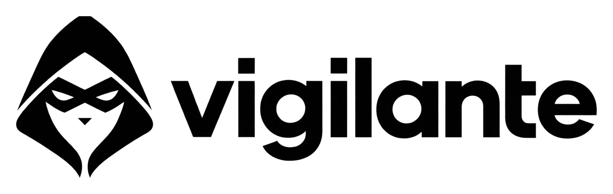

<div align="center">
  
  <p><b>See what a pull request lets your code, your CI, and your AI agents do, before you merge it.</b></p>
  <p>
    <a href="https://github.com/theonly1me/vigilante/actions/workflows/ci.yml"></a>
    <a href="https://github.com/theonly1me/vigilante/releases/latest"></a>
    <a href="https://crates.io/crates/vigilante"></a>
    <a href="https://www.npmjs.com/package/@theonly1me/vigilante"></a>
    <a href="https://pypi.org/project/vigilante-scan/"></a>
    <a href="#license"></a>
    <a href="https://github.com/theonly1me/vigilante/blob/main/Cargo.toml"></a>
  </p>
</div>

Vigilante reads a pull request and lists the new powers that it adds. A power is something like the first `subprocess` call in a package, a CI token that can push, a new MCP server that your agents connect to, or a new install script. You approve powers in a `vigilante.lock` file that your security team owns. If a pull request adds a power that is not in the lock, the check fails.

Vigilante never runs code from the repository that it checks. It reads files, and for Go it type-checks the code with [Capslock](https://github.com/google/capslock).

## Why

AI agents open more pull requests than people can read line by line. A one-line change to `.mcp.json`, `.claude/settings.json`, a workflow, or a `postinstall` script changes what every later agent run and CI job can do. Vigilante puts those changes at the top of the pull request, in the same format for every language and every kind of file.

## Example

An agent opens a pull request that exports invoices. Vigilante reports this:

> ## Vigilante: this pull request adds 6 new powers
>
> | Severity | Scope | Power | What it means | Evidence | Status |
> | --- | --- | --- | --- | --- | --- |
> | HIGH | `services/billing` (code) | `exec` | Can run other programs | `services/billing/billing/export.py:1` | **not in lock** |
> | HIGH | `.mcp.json` (agent) | `mcp_server:fs-tools: npx -y fs-tools-mcp` | The agent connects to an MCP server | `.mcp.json:3` | **not in lock** |
> | MEDIUM | `.github/workflows` (ci) | `third_party_action:acme-tools/publish-action` | The workflow runs a third-party action | `.github/workflows/release.yml:12` | **not in lock** |
> | MEDIUM | `.github/workflows/release.yml` (ci) | `token_write:contents` | The CI token can write to the repository | `.github/workflows/release.yml:6` | **not in lock** |
> | MEDIUM | `.github/workflows/release.yml` (ci) | `secret:PYPI_TOKEN` | The workflow reads a secret | `.github/workflows/release.yml:14` | **not in lock** |
> | MEDIUM | `.claude/settings.json` (agent) | `tool_allow:Bash(curl:*)` | The agent can use a tool without asking | `.claude/settings.json:3` | **not in lock** |
>
> **Result: fail.** 6 powers are not in vigilante.lock. Run `vigilante lock` and commit the file.

The same pull request also added a second network call to `services/billing`, the allow rules `Bash(pytest:*)` and `Read`, and a call to `actions/checkout`. Vigilante does not report them. The package already used the network, Vigilante treats an allow rule for a test runner as low risk, `Read` only reads files, and `actions/` is first party.

## What it checks

| Surface | Files | Powers |
| --- | --- | --- |
| Code | Rust, JavaScript, TypeScript, Python, Ruby, C#, Java, and Go | `exec`, `network`, `files`, `native`, `dynamic_code`, `read_system_state`, `modify_system_state`, `system_calls` |
| Go, through dependencies | Every Go module, with [Capslock](https://github.com/google/capslock) | All 13 Capslock capabilities, with the call path, including `operating_system`, `runtime`, `arbitrary_execution`, and `unanalyzed` |
| CI | `.github/workflows/*.yml` | `token_write`, `oidc`, `untrusted_trigger`, `third_party_action`, `secret` |
| AI agents | `.claude/settings.json`, `.mcp.json`, `.cursor/mcp.json`, `.vscode/mcp.json`, `.codex/config.toml`, `.gemini/settings.json` | `tool_allow`, `hook`, `mcp_server`, `skip_permissions` |
| Build | `package.json` install scripts, `build.rs`, `setup.py`, `.husky/`, `.pre-commit-config.yaml` | `install_hook`, `git_hook` |

Vigilante reports a power only the first time that it appears in a scope. For code, a scope is the nearest package root, and for Go it is the Go package. Tests, fixtures, and vendored code are skipped. [docs/powers.md](docs/powers.md) explains each power and the rules that keep the report short.

For Go, Vigilante also reports new packages on a call path to a power, as `capslock-git-diff` does. A new dependency that reaches the network shows up there, even when the package already used the network. These notes do not fail the check.

## Install

Vigilante is one static binary for Linux and macOS (x86_64 and arm64). Use the package manager that your team already has. The command is always `vigilante`.

| Package manager | Command |
| --- | --- |
| npm | `npm install --save-dev @theonly1me/vigilante` or `npx @theonly1me/vigilante` |
| PyPI | `pip install vigilante-scan` or `uvx --from vigilante-scan vigilante` |
| Homebrew | `brew install theonly1me/tap/vigilante` |
| Cargo | `cargo install vigilante --locked` |
| GitHub Releases | Download `vigilante-<target>.tar.gz` from the [releases page](https://github.com/theonly1me/vigilante/releases) |

Each release archive has a build attestation. To check that an archive came from this repository's release workflow, run this command:

```sh
gh attestation verify vigilante-x86_64-unknown-linux-musl.tar.gz --repo theonly1me/vigilante
```

Windows is not supported yet. To check Go code, Vigilante needs `go` and `capslock` (`go install github.com/google/capslock/cmd/capslock@v0.3.3`). The GitHub Action installs both.

## Quick start

Run these commands in the root of your repository.

| Command | What it does |
| --- | --- |
| `vigilante scan` | Prints every power in the repository |
| `vigilante lock` | Writes `vigilante.lock`. Commit this file. |
| `vigilante diff --base origin/main` | Reports the powers that your branch adds, compared with its merge base |
| `vigilante check` | Fails when `vigilante.lock` does not match the repository |

`diff` and `check` print Markdown by default. Add `--format json` or `--format sarif` for other tools.

| Exit code | Meaning |
| --- | --- |
| 0 | Pass |
| 1 | A power is not in the lock, the lock is stale, or a `deny` rule matches |
| 2 | Error, for example a file that Vigilante cannot parse |

## Run it on every pull request

Add `.github/workflows/vigilante.yml`:

```yaml
name: Vigilante
on:
  pull_request:
  push:
    branches: [main]
permissions:
  contents: read
jobs:
  vigilante:
    runs-on: ubuntu-latest
    steps:
      - uses: actions/checkout@v7
        with:
          fetch-depth: 0
          persist-credentials: false
      - uses: theonly1me/vigilante@v0.1.0
```

On a pull request, the action runs `vigilante diff` against the base branch. On a push, it runs `vigilante check`. The report goes to the job summary. The job needs no secrets, so it also works on pull requests from forks.

Then give the lock file to your security team in `CODEOWNERS`, and turn on "Require review from Code Owners":

```text
vigilante.lock      @your-org/security
vigilante.toml      @your-org/security
.github/            @your-org/security
```

Every pull request that adds a power must now change `vigilante.lock`, and that change needs a review from the security team. [docs/github-action.md](docs/github-action.md) has the full setup, how to protect the check, and how to run Vigilante in other CI systems.

## Use it with AI agents

Tell your agents to run `vigilante diff --base origin/main` before they open a pull request, and to run `vigilante lock` when they add a power on purpose. The new powers are then in the pull request description, and the lock change asks for the right review.

## Configuration

Vigilante works with no configuration. To change what it reports, add `vigilante.toml`:

```toml
[scan]
exclude = ["examples/**"]

[policy]
deny = [{ scope = "services/**", capability = "exec" }]

[ci]
trusted_owners = ["your-org"]
```

In a pull request, Vigilante reads `vigilante.toml` from the merge base, so a pull request cannot change the rules that check it. [docs/configuration.md](docs/configuration.md) lists every key, the lock format, and how to add rules for your own wrappers.

## What Vigilante is not

- It is not a malware detector. It shows what changed, and a person decides if the change is acceptable.
- For Go, it follows calls into every dependency. For the other languages, it sees direct use in your code, not what a dependency does inside.
- It uses no AI to find or rank powers. The same input gives the same output, offline, in seconds.

## License

Licensed under either of [Apache License 2.0](LICENSE-APACHE) or [MIT license](LICENSE-MIT), at your option.
