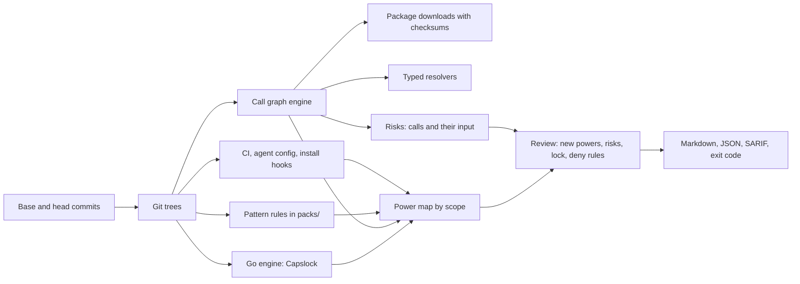
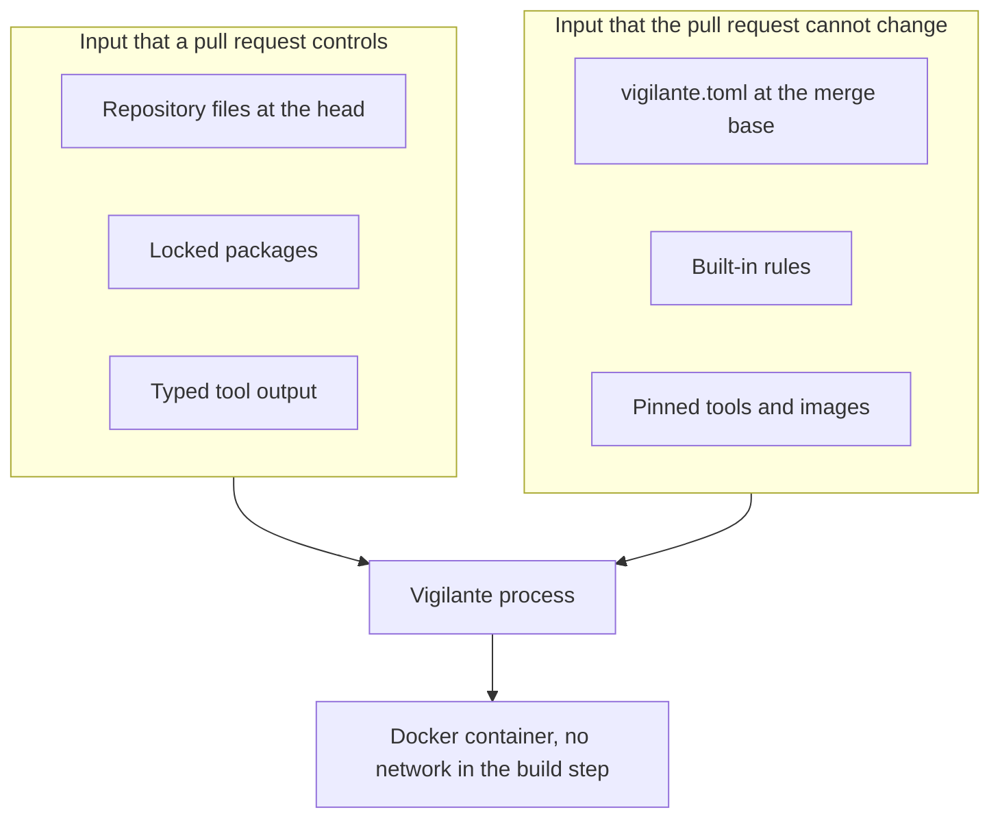

# Architecture

Vigilante reads two commits of a repository and compares the powers in each. This page shows the flow, the modules, and the trust boundaries. The [design records](design/README.md) give the reasons for each decision.

## Flow

1. `vigilante diff` finds the merge base of the base and the head. It reads `vigilante.toml` from the merge base.
2. It lists the changed files and the scopes that they are in.
3. For each commit, it finds the powers in those scopes:
   - The surface readers parse workflows, composite actions, agent config, skill and command frontmatter, and install hooks. They also give the CI risks, such as untrusted text in a script.
   - The pattern rules match privileged calls and imports in code.
   - The call graph engine follows calls into the locked packages.
   - The Go engine runs Capslock.
4. The review keeps the powers and the risks that the head has and the merge base does not have. It compares them with `vigilante.lock` and the `deny` rules.
5. The report gives the findings, the notes, the lines under "Not analyzed", and the exit code.

## Modules

| Module | Job |
| --- | --- |
| `src/tree/` | Reads files at a commit with `git ls-tree` and `git cat-file`, or from a folder. |
| `src/config/`, `src/scope.rs`, `src/lock.rs` | Reads `vigilante.toml`, finds scopes, and reads and writes `vigilante.lock`. |
| `src/surfaces/` | Finds CI, agent, and build powers. |
| `src/code/`, `packs/` | Runs the ast-grep rules for each language. |
| `src/deep/` | Makes the call graph, finds the shortest path to each sink, and sorts each path into a finding or a note. |
| `src/<language>/` | Gives the parser, the import resolver, and the typed resolver of a language. |
| `src/lockfiles/`, `src/registry/` | Reads lockfiles, downloads packages, checks checksums, and extracts archives. |
| `src/scip/` | Reads SCIP indexes from scip-python and rust-analyzer. |
| `src/container/`, `src/process/` | Runs Docker builds with no network, and child processes with a time limit. |
| `src/go/` | Runs Capslock and maps its capabilities to powers. |
| `src/review/`, `src/report/` | Compares the two commits, applies the lock, and writes the report. |

## Trust boundaries

- Vigilante reads repository files through git. It does not check out the repository, except for a shared clone in a temporary folder for Capslock.
- A pull request cannot change `vigilante.toml`, because Vigilante reads it from the merge base.
- Vigilante downloads packages only from public registries and from the registries in `[registries] allow`. It checks each package against a checksum, rejects archive paths outside the target folder, and never runs package code.
- Vigilante pins each typed tool by checksum or by digest. The TypeScript checker and scip-python read code and do not run it.
- `[engines] rust = "typed"` runs build code in a Docker container. The container downloads crates with network access. Then Vigilante disconnects the network, and the container runs the build. The source is read-only, and only the output folder is writable.
- Vigilante treats the output of a typed tool as untrusted. A typed result can remove a note, but it cannot remove a finding.
- Each child process has a time limit. When a tool reaches its limit, Vigilante stops it and resolves calls by name.
- Input that Vigilante cannot read stops the run with exit code 2, so the check fails closed.
